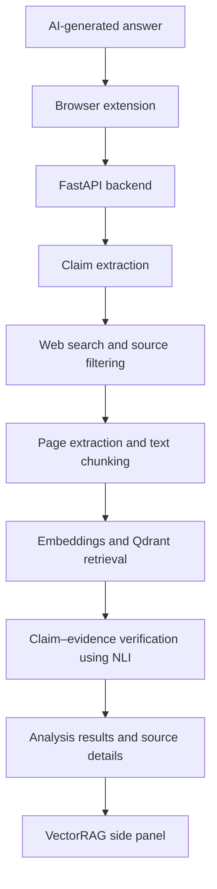

<div align="center">

# VectorRAG

### Evidence-grounded verification for more reliable AI responses

**An adaptive Retrieval-Augmented Generation framework for detecting, evaluating, and reducing unsupported claims in AI-generated answers.**

[](https://www.python.org/)
[](https://fastapi.tiangolo.com/)
[](https://developer.mozilla.org/en-US/docs/Web/JavaScript)
[](https://qdrant.tech/)
[](https://developer.chrome.com/docs/extensions/develop/migrate/what-is-mv3)

[Overview](#overview) · [Features](#key-features) · [Architecture](#system-architecture) · [Tech Stack](#technology-stack) · [Setup](#getting-started) · [API](#api-reference) · [Roadmap](#roadmap)

</div>

---

## Overview

Large Language Models can produce answers that sound convincing while containing inaccurate, misleading, or unsupported claims. Retrieval-Augmented Generation (RAG) helps by bringing external information into the generation process—but **retrieval alone does not guarantee that every statement in an answer is grounded in evidence**.

**VectorRAG** is a browser-extension-based research project that helps assess the factual support behind AI-generated responses. It combines web evidence collection, source filtering, semantic retrieval, and natural-language-inference (NLI) techniques to evaluate claims against available evidence.

The goal is not to declare every answer absolutely true or false. It is to help users inspect **what appears supported, what may be contradicted, and what cannot be verified from the evidence found**.

<div align="center">

| Retrieve evidence | Verify claims | Review sources |
|:---:|:---:|:---:|
| Find potentially relevant web content | Compare claims with retrieved evidence | Inspect evidence behind an assessment |

</div>

> **Project status:** Under development. Verification results depend on the relevance, quality, and availability of retrieved sources.

## Contents

<div align="center">

| Start here | Explore the system | Run and develop |
|:---|:---|:---|
| [Overview](#overview) | [System Architecture](#system-architecture) | [Getting Started](#getting-started) |
| [Problem Statement](#problem-statement) | [Technology Stack](#technology-stack) | [Browser Extension](#load-the-browser-extension) |
| [Key Features](#key-features) | [Project Structure](#project-structure) | [API Reference](#api-reference) |
| [How It Works](#how-it-works) | [Limitations](#limitations) | [Testing](#testing) |
|  | [Roadmap](#roadmap) | [Contributors](#contributors) |

</div>

## Problem Statement

AI-generated responses may contain claims that are:

- Not supported by the available context or cited sources.
- Inconsistent with retrieved evidence.
- Plausible-sounding but unverifiable.
- Partially correct while mixing supported and unsupported details.

A reliable AI workflow needs more than document retrieval: it needs a way to examine claims against evidence and make uncertainty visible. VectorRAG explores this verification layer for AI responses viewed through a browser extension.

## Key Features

<table>
  <tr>
    <td width="50%">

### Browser side panel

A dedicated Manifest V3 extension interface for using VectorRAG alongside supported AI chat websites.

</td>
    <td width="50%">

### Claim-level verification

Examines answer statements individually instead of treating an entire response as one indivisible result.

</td>
  </tr>
  <tr>
    <td>

### Web evidence collection

Collects candidate web pages and extracts readable text for evidence processing.

</td>
    <td>

### Semantic retrieval

Uses text embeddings and Qdrant vector search to locate potentially relevant evidence chunks.

</td>
  </tr>
  <tr>
    <td>

### Source trust and relevance filtering

Applies configurable trust and relevance thresholds to help prioritize evidence.

</td>
    <td>

### NLI-based analysis

Uses natural-language-inference signals to assess whether evidence supports or conflicts with a claim.

</td>
  </tr>
</table>

The extension's current manifest is configured for ChatGPT, Gemini, Claude, and Microsoft Copilot. Site behavior can change, so compatibility should be validated against the current versions of those websites.

## How It Works

<div align="center">



</div>

### Verification pipeline

1. **Capture** — The extension obtains answer content from a supported AI chat interface.
2. **Extract** — The backend identifies statements that can be assessed individually.
3. **Search** — Web-search logic gathers candidate sources relevant to those statements.
4. **Process** — Page content is extracted, cleaned, and split into manageable text chunks.
5. **Retrieve** — Sentence embeddings and Qdrant search help find relevant evidence.
6. **Evaluate** — The verifier compares claims with available evidence using NLI and relevance signals.
7. **Present** — Results, evidence, and source information are returned for review in the extension.

These stages describe the intended high-level pipeline; the exact behavior and output fields are defined by the current implementation.

## System Architecture

VectorRAG is organized into two main components:

| Component | Responsibility |
|---|---|
| Browser extension | Integrates with supported AI chat pages and displays the side-panel interface. |
| FastAPI backend | Coordinates analysis, evidence collection, retrieval, verification, and API responses. |
| Sentence Transformers | Converts text into vector embeddings for semantic retrieval. |
| Qdrant | Stores and retrieves evidence vectors. |
| Web extraction and search modules | Collect candidate sources and process their page content. |
| NLI verifier | Estimates the relationship between an individual claim and the retrieved evidence. |

## Technology Stack

<div align="center">

| Layer | Technologies |
|:---|:---|
| **Browser extension** | JavaScript, HTML5, CSS3, Chrome Extension Manifest V3 |
| **Backend API** | Python, FastAPI, Pydantic |
| **Machine learning** | PyTorch, Sentence Transformers |
| **Embedding model** | `sentence-transformers/all-MiniLM-L6-v2` |
| **NLI model** | `cross-encoder/nli-MiniLM2-L6-H768` |
| **Vector database** | Qdrant |
| **Web processing** | Requests, Beautiful Soup, lxml |
| **Local services** | Docker Compose |
| **Testing** | pytest |

</div>

## Project Structure

```text
VectorRAG/
├── backend/
│   ├── __init__.py
│   ├── config.py
│   ├── document_processor.py
│   ├── embeddings.py
│   ├── main.py
│   ├── qdrant_manager.py
│   ├── rag_pipeline.py
│   ├── requirements.txt
│   ├── test_verifier.py
│   ├── trusted_sources.py
│   ├── verifier.py
│   └── web_search.py
├── extension/
│   ├── background.js
│   ├── content.js
│   ├── manifest.json
│   ├── sidepanel.css
│   ├── sidepanel.html
│   └── sidepanel.js
├── docker-compose.yml
├── .gitignore
└── README.md
```

## Getting Started

### Prerequisites

Install the following before running the project:

- Python 3.10 or later, with a version compatible with the pinned dependencies.
- Git.
- Docker Desktop or a compatible Docker Compose installation.
- A Chromium-based browser that supports Manifest V3 side panels, such as Chrome or Microsoft Edge.
- Internet access for downloading models and retrieving web pages.

The first startup may take time because machine-learning model files may need to be downloaded. Model inference can use substantial RAM and CPU.

### 1. Clone the repository

```bash
git clone https://github.com/Mobasheera/VectorRAG.git
cd VectorRAG
```

Alternatively, extract the project ZIP and open a terminal in the extracted project directory.

### 2. Create a virtual environment

**Windows PowerShell**

```powershell
py -m venv .venv
.\.venv\Scripts\Activate.ps1
```

If activation is blocked, use Command Prompt:

```bat
.venv\Scripts\activate.bat
```

**macOS / Linux**

```bash
python3 -m venv .venv
source .venv/bin/activate
```

### 3. Install Python dependencies

From the repository root:

```bash
pip install -r backend/requirements.txt
```

### 4. Start Qdrant

Make sure Docker Desktop is running, then run:

```bash
docker compose up -d
```

The supplied Compose file exposes Qdrant on:

| Service | Address |
|---|---|
| Qdrant HTTP API | `http://localhost:6333` |
| Qdrant gRPC | `localhost:6334` |

### 5. Start the backend

From the repository root:

```bash
uvicorn backend.main:app --host 127.0.0.1 --port 8000
```

Open these addresses to check the service:

| Resource | URL |
|---|---|
| Backend status | http://127.0.0.1:8000/ |
| Interactive API documentation | http://127.0.0.1:8000/docs |
| Qdrant status | http://127.0.0.1:8000/qdrant-status |

Keep this terminal running while using the extension.

**Import troubleshooting:** If Python reports an import-path error, the current source may expect the backend directory as its working directory. In that case, stop the server and try:

```bash
cd backend
uvicorn main:app --host 127.0.0.1 --port 8000
```

Use the launch method that matches the import structure in your checked-out version.

## Load the Browser Extension

1. Start Qdrant and the backend API.
2. Open `chrome://extensions` in Chrome or `edge://extensions` in Edge.
3. Enable **Developer mode**.
4. Select **Load unpacked**.
5. Choose the project's `extension/` folder.
6. Open a supported AI chat website.
7. Select the VectorRAG extension to open its side panel.

The extension is configured to communicate with a local backend on port `8000`. If you change the host or port, update the extension's backend URL and manifest host permissions accordingly.

## API Reference

The backend exposes the following endpoints in the current source:

| Method | Endpoint | Purpose |
|:---:|---|---|
| `GET` | `/` | Returns service status and configuration information. |
| `POST` | `/analyze` | Analyzes an answer and returns claim/evidence results. |
| `GET` | `/qdrant-status` | Checks Qdrant connectivity or status. |
| `GET` | `/qdrant-info` | Returns Qdrant collection information. |
| `DELETE` | `/reset-qdrant` | Resets Qdrant data or collection state. |

For exact request schemas and response fields, run the backend and visit [the interactive API documentation](http://127.0.0.1:8000/docs).

> **Caution:** `/reset-qdrant` is a destructive operation. Do not call it unless you intend to reset the vector database.

## Configuration

Optional environment variables are loaded by the backend through `python-dotenv`. Defaults are defined in `backend/config.py`.

| Variable | Default | Description |
|---|---:|---|
| `QDRANT_URL` | `http://127.0.0.1:6333` | Qdrant connection URL |
| `QDRANT_COLLECTION` | `trusted_web_sources` | Vector collection name |
| `EMBEDDING_MODEL` | `sentence-transformers/all-MiniLM-L6-v2` | Embedding model identifier |
| `NLI_MODEL` | `cross-encoder/nli-MiniLM2-L6-H768` | NLI model identifier |
| `MAX_WEB_RESULTS` | `8` | Maximum web results configured |
| `TOP_K_QDRANT` | `12` | Vector retrieval candidate count |
| `MIN_RETRIEVAL_SIMILARITY` | `0.40` | Minimum retrieval similarity |
| `MAX_FINAL_EVIDENCE` | `8` | Maximum final evidence chunks |
| `MIN_TRUST_SCORE` | `0.70` | Minimum source trust score |
| `CHUNK_SIZE` | `900` | Text chunk-size setting |
| `CHUNK_OVERLAP` | `150` | Chunk overlap setting |

Additional NLI and relevance settings are available in `backend/config.py`. These values are implementation defaults, not universal accuracy guarantees.

Keep credentials and API keys out of source control. If the project needs a `.env` file, add only variables actually used by the current code and do not commit secrets.

## Testing

A verifier test module is included:

```bash
python -m pytest backend/test_verifier.py
```

If pytest is not installed in the active environment:

```bash
pip install pytest
```

Some tests may require model downloads or other runtime dependencies. Review test output and implementation details when interpreting results.

## Limitations

- Verification quality depends on the relevance, completeness, and reliability of retrieved evidence.
- Search ranking and trust heuristics may miss useful sources or favor particular domains.
- Semantic similarity and NLI scores are model estimates, not proof that a claim is true or false.
- Websites may block automated requests or change their page structure.
- Model downloads and inference may require significant memory, CPU, and network bandwidth.
- High-stakes decisions should not rely on VectorRAG alone; independent expert review remains important.
- Integrations with third-party AI chat sites may need maintenance as those sites change.

## Roadmap

Potential future development areas include:

- Benchmark-based evaluation of claim-verification precision and recall.
- More transparent claim-to-evidence attribution.
- Calibrated confidence and clearer handling of inconclusive evidence.
- Additional search providers and evidence sources.
- Reduced model loading time and inference latency.
- Broader automated tests, better error handling, and reproducible evaluation.
- Improved usability and accessibility in the browser side panel.

## Contributors

VectorRAG is an academic major project. Add the final team member names, roles, and contribution details here once they have been agreed upon.

## License

The current project snapshot does not include an explicit open-source license file. Until a license is added, reuse and redistribution remain subject to applicable copyright law. Add a license if the team intends to grant specific permissions for public use.

---

<div align="center">

**VectorRAG**

*Making AI responses easier to question, inspect, and verify.*

<sub>Academic research project · Under development</sub>

</div>
